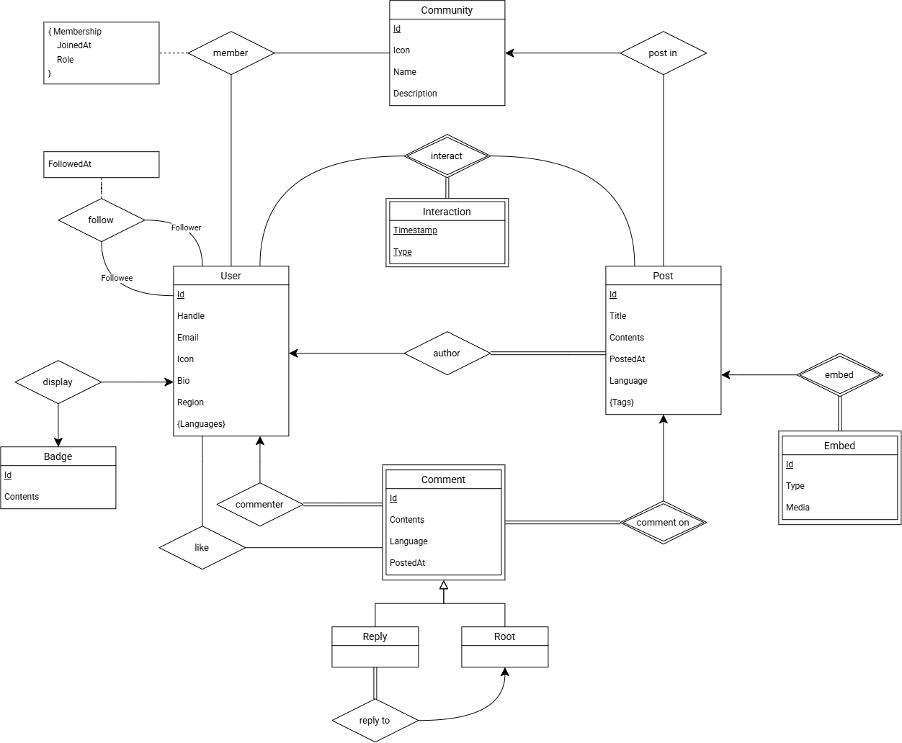

# Conceptual Model

### Conceptual Data Model: ER Diagram

### Conceptual Queries

- Each entity/relationship (E/R) referred are distinguished using the monospace style.  
  Ex: `Post`, `author`, `member`.
- An E/R reference can be bind to a variable to be referenced further later, denoted by square brackets (inspired by the ER Query Language developed by Lawley, 1994).  
  Ex: `Post [P]`, `member [m]`. Entities use uppercase letters,  relationships use lowercase.
- E/R attributes are written using dot notation. The asterisk `*` can be used to refer to all attributes of an E/R.  
  Ex: `P.PostedAt`, `m.Membership.Role`, `P.*`, `m.*`.
- Relationship roles are written descriptively in the Description field, just to distinguish entities.
- The tilde `~` in the Limit field denotes unlimited amount.
- The "main E/R" being projected by a query can be inferred from:
  - The first E/R mentioned in the Description field (e.g. "Find `Post [P]`" means main E/R is `P`).
  - The first E/R listed in the Projection field.
  - The E/R in the Limit field.

##### Q01: Recent Posts by Users Followed

|    Field    |    Value    |
|-------------|-------------|
| ID          | Q01
| Title       | Recent Posts by Users Followed
| Description | Find all `Post [P]` by all `author` `User [A]` who are `Followee` of `User [U]`
| Projection  | - `P.*`
|             | - `A.Id`, `A.Handle`, `A.Icon`
|             | - For `P` `post in` `Community [C]`: `C.Id` and `C.Name`
| Filtering   | `U.Id = ?`
| Ordering    | `P.PostedAt` descending
| Frequency   | 100
| Limit       | 100 `P`

##### Q02: Recent Posts in Joined Communities

|    Field    |    Value    |
|-------------|-------------|
| ID          | Q02
| Title       | Recent Posts in Joined Communities
| Description | Find all `Post [P]` `in` all `Community [C]` which has `member` `User [U]`
| Projection  | - `P.*`
|             | - For `User [A]` `author` of `P`: `A.Id`, `A.Handle`, `A.Icon`
|             | - `C.Id` and `C.Name`
| Filtering   | `U.Id = ?`
| Ordering    | `P.PostedAt` descending
| Frequency   | 100
| Limit       | 100 `P`

##### Q03: Recent Posts by Tag

|    Field    |    Value    |
|-------------|-------------|
| ID          | Q03
| Title       | Recent Posts by Tag
| Description | Find all `Post [P]` based on its `Tags`
| Projection  | - `P.*`
|             | - For `User [A]` `author` of `P`: `A.Id`, `A.Handle`, `A.Icon`
|             | - For `P` `post in` `Community [C]`: `C.Id` and `C.Name`
| Filtering   | `P.Tags contains ?`
| Ordering    | `P.PostedAt` descending
| Frequency   | 100
| Limit       | 100 `P`

##### Q04: Top Root Comments

|    Field    |    Value    |
|-------------|-------------|
| ID          | Q04
| Title       | Top Root Comments
| Description | Find all `Root Comment [R]` `comment on` `Post [P]` with the most number of `like [λ]`s
| Projection  | - `R.*`
|             | - `Count(λ)`
|             | - For `User [A]` `author` of `R`: `A.Id`, `A.Handle`, `A.Icon`
| Filtering   | `P.Id = ?`
|             | `R is Root`
| Ordering    | `Count(λ)` descending
| Frequency   | 50
| Limit       | ~ `R`

##### Q05: Chronological Reply Comments

|    Field    |    Value    |
|-------------|-------------|
| ID          | Q05
| Title       | Chronological Reply Comments
| Description | Find all `Reply Comment [R]` `reply to` `Comment [R₀]`
| Projection  | - `R.*`
|             | - For all `like [λ]` of `R`: `Count(λ)`
|             | - For `User [A]` `author` of `P`: `A.Id`, `A.Handle`, `A.Icon`
| Filtering   | `P.Id = ?`
|             | `R₀.Id = ?`
| Ordering    | `R.PostedAt` ascending
| Frequency   | 25
| Limit       | ~ `R`

##### Q06: Recent Post Interactions

|    Field    |    Value    |
|-------------|-------------|
| ID          | Q06
| Title       | Recent Post Interactions
| Description | Find all `Interaction [I]` `interact` of `Post [P]`
| Projection  | - `I.*`
|             | - For `User [U]` `interact` with `P`: `U.Id`, `U.Handle`, `U.Icon`, `U.Region`, `U.Languages`
| Filtering   | `P.Id = ?`
| Ordering    | `I.Timestamp` descending
| Frequency   | 100
| Limit       | 100 `I`

##### Q07: Recent User Interactions

|    Field    |    Value    |
|-------------|-------------|
| ID          | Q07
| Title       | Recent User Interactions
| Description | Find all `Interaction [I]` `interact` by `User [U]`
| Projection  | - `I.*`
|             | - For `U` `interact` with `Post [P]`: `P.*`
|             | - For `User [A]` `author` of `P`: `A.Id`, `A.Handle`, `A.Icon`
|             | - For `P` `post in` `Community [C]`: `C.Id` and `C.Name`
| Filtering   | `U.Id = ?`
|             | `I.Type = ?`
| Ordering    | `I.Timestamp` descending
| Frequency   | 100
| Limit       | 100 `I`

##### Q08: Followed Users

|    Field    |    Value    |
|-------------|-------------|
| ID          | Q08
| Title       | Followed Users
| Description | Find all `User [F]`, `Followee` who `follow [f]` `User [U]`
| Projection  | - `F.Id`, `F.Handle`, `F.Icon`, `F.Email`, `F.Bio`
|             | - `f.*`
| Filtering   | `U.Id = ?`
| Ordering    | `f.FollowedAt` descending
| Frequency   | 50
| Limit       | ~ `U`

##### Q09: Joined Communities

|    Field    |    Value    |
|-------------|-------------|
| ID          | Q09
| Title       | Joined Communities
| Description | Find all `Community [C]` which has `member [m]` `User [U]`
| Projection  | - `C.*`
|             | - `m.*`
| Filtering   | `U.Id = ?`
| Ordering    | `m.Membership.JoinedAt` descending
| Frequency   | 50
| Limit       | ~ `C`

##### Q10: Community Members

|    Field    |    Value    |
|-------------|-------------|
| ID          | Q10
| Title       | Community Members
| Description | Find all `User [U]` who are `member [m]` of `Community [C]`
| Projection  | - `U.Id`, `U.Handle`, `U.Icon`
|             | - `m.*`
| Filtering   | `C.Id = ?`
| Ordering    | - `m.Membership.Role` ascending
|             | - `m.Membership.JoinedAt` ascending
| Frequency   | 50
| Limit       | ~ `U`

##### Q11: Community Members by Role

|    Field    |    Value    |
|-------------|-------------|
| ID          | Q11
| Title       | Community Members by Role
| Description | Find all `User [U]` who are `member [m]` of `Community [C]` by their `Role`
| Projection  | - `U.Id`, `U.Handle`, `U.Icon`
|             | - `m.*`
| Filtering   | `C.Id = ?`
|             | `m.Membership.Role = ?`
| Ordering    | `m.Membership.JoinedAt` ascending
| Frequency   | 50
| Limit       | ~ `U`

##### Q12: User Info

|    Field    |    Value    |
|-------------|-------------|
| ID          | Q12
| Title       | User Info
| Description | Find `User [U]`
| Projection  | - `U.*`
|             | - For `U` `display` `Badge [B]`: `B.*`
| Filtering   | `U.Id = ?`
| Ordering    | -
| Frequency   | 5
| Limit       | 1 `U`

##### Q13: Post Info

|    Field    |    Value    |
|-------------|-------------|
| ID          | Q13
| Title       | Post Info
| Description | Find `Post [P]`
| Projection  | - `P.*`
|             | - For all `P` `embed` `Embed [E]`: `E.*`
|             | - For `User [A]` `author` of `P`: `A.Id`, `A.Handle`, `A.Icon`
|             | - For `P` `post in` `Community [C]`: `C.Id` and `C.Name`
| Filtering   | `P.Id = ?`
| Ordering    | -
| Frequency   | 5
| Limit       | 1 `P`

##### Q14: Community Info

|    Field    |    Value    |
|-------------|-------------|
| ID          | Q14
| Title       | Community Info
| Description | Find `Community [C]`
| Projection  | - `C.*`
|             | - For all `User [O]` `member [m]` of `C`: `O.Id`, `O.Handle`, `O.Icon`
| Filtering   | `C.Id = ?`
|             | `m.Membership.Role = "Owner"`
| Ordering    | -
| Frequency   | 5
| Limit       | 1 `C`

##### Q15: Comment Likes

|    Field    |    Value    |
|-------------|-------------|
| ID          | Q15
| Title       | Comment Likes
| Description | Find all `User [U]` who `like` `Comment [R]` on `Post [P]`
| Projection  | - `U.Id`, `U.Handle`, `U.Icon`
| Filtering   | `C.Id = ?`
|             | `P.Id = ?`
| Ordering    | -
| Frequency   | 5
| Limit       | ~ `U`

## Read more

- [00: Intro](./README.md)
- [02: Logical Model](./02_LogicalModel.md)
- [03: Input](./03_Input.md)