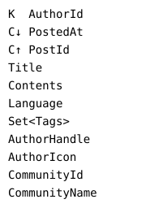
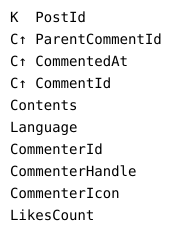
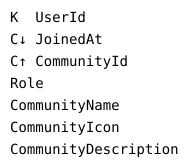
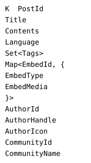
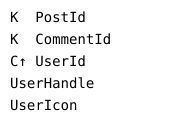

# Logical Model

### Tables

| ID |          Name           |         Structure          |   Usage   |
|:--:|-------------------------|:--------------------------:|-----------|
| Pa | RecentPostsByAuthor     |  | Q01       |
| Pc | RecentPostsInCommunity  |  | Q02       |
| Pt | RecentPostsByTag        |  | Q03       |
| R  | Comments                |  | Q04, Q05  |
| Ip | RecentPostsInteractions |  | Q06       |
| Iu | RecentUserInteractions  |  | Q07       |
| F  | Followings              |  | Q01, Q08  |
| Mu | UserMemberships         |  | Q02, Q09  |
| Mc | CommunityMembers        |  | Q10, Q11  |
| U  | Users                   |  | Q12       |
| P  | Posts                   |  | Q13       |
| C  | Communities             |  | Q14       |
| L  | Likes                   |  | Q15       |

### Query Execution Plans

##### Workload Cost

NoSE's workload cost model (read queries only):


The term `C_ij` stands for the cost of table `j` for query `i`, defined by

```
C = T(n, w) + ∆
```

where `T` is defined as the projected runtime for `n` queries against a table with `w` columns.
∆ is the overhead of external filtering/ordering.

Our preliminary testing results in the following formula for `T`:

```
T(n, w) = 0.5n + w + 0.01nw + 5
```

The testing itself could be found in [`/prelim`](/prelim).

##### Query Plan

In NoSE, a query plan is a specified set of operations which consist of:

- `get` operation against a particular table.
- External filtering (`filter`) or ordering (`sort`) operation against a column/field on the results of previously specified `get` operation.

##### The Query Plans & Cost

|  Q  |  f  |    Step    |      n      |  w  | ∆ |        C        |       ∑C×f       |
|-----|-----|------------|-------------|-----|---|----------------:|-----------------:|
| Q01 | 100 | get F      |           1 |   6 | - |           11.56 | 60Nf/u + 2656.00 |
|     |     | get Pa     |  Nfoll/user |  10 | - | 0.6Nf/u + 15.00 |                  |
| Q02 | 100 | get Mu     |           1 |   6 | - |           11.56 | 60Nm/u + 2656.00 |
|     |     | get Pc     |  Nmemb/user |  10 | - | 0.6Nm/u + 15.00 |                  |
| Q03 | 100 | get Mu     |           1 |  11 | - |           16.61 |          1661.00 |
| Q04 |  50 | get R      |           1 |   9 | - |           15.59 |           779.50 |
|     |     | sort like  |      -      |  -  | 1 |                 |                  |
| Q05 |  25 | get R      |           1 |   9 | - |           14.59 |           364.75 |
| Q06 | 100 | get Ip     |           1 |   7 | - |           12.57 |          1257.00 |
| Q07 | 100 | get Iu     |           1 |  11 | - |           16.61 |          1661.00 |
| Q08 |  50 | get F      |           1 |   6 | - |           11.56 |           578.00 |
| Q09 |  50 | get Mu     |           1 |   6 | - |           11.56 |           578.00 |
| Q10 |  50 | get Mc     |           1 |   5 | - |           11.55 |           577.50 |
|     |     | sort join  |      -      |  -  | 1 |                 |                  |
| Q11 |  50 | get Mc     |           1 |   5 | - |           10.55 |           527.50 |
| Q12 |   5 | get U      |           1 |   8 | - |           12.57 |            62.85 |
| Q13 |   5 | get P      |           1 |  11 | - |           16.61 |            83.05 |
| Q14 |   5 | get C      |           1 |   4 | - |            9.54 |            47.70 |
| Q15 |   5 | get L      |           1 |   3 | - |            8.53 |            42.65 |