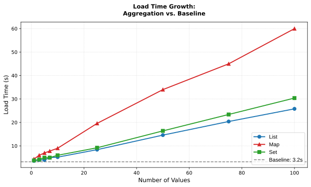
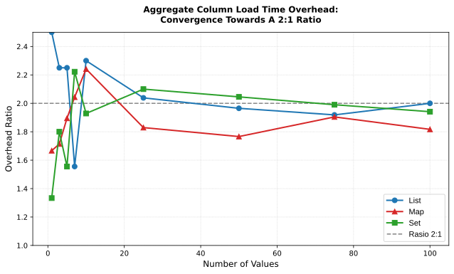

# Aggregation Preliminary Tests

The objective in this module is to fit the overhead cost function `T_overhead_set(𝑝,𝑟,𝑣)` and
`T_overhead_set(𝑝,𝑟,𝑣)`. The relevant files are `regress-set.py` and`regress-map.py` which uses
the dataset `set.csv`, `map.csv`, and `base.csv`. The other files are used for explanations.

##### Fitting The Set Cost Model

Running `regress-set.py` results in the following cost model:

```
T_overhead_set(𝑝, 𝑟, 𝑣) = (1.52 * 𝑝𝑟𝑣 * 10^-6) - 0.4
```

The linear model with the product interaction term 𝑝𝑟𝑣 is chosen **after** analyzing the dataset
`set.csv` and trying out several different models. 

The dataset `set.csv` was collected using the test scripts with the following configurations:

```
Table type                    : agg-pn
Aggregation type              : set
No. of partitions         (𝑝) : 100, 200, 300, 500
No. of rows/partition     (𝑟) : 100, 200, 300, 500, 750, 1000
No. of columns            (𝑐) : 14
No. of aggregate columns  (𝑎) : 1
No. of collection values  (𝑣) : 3, 5, 7, 10, 25, 50, 75, 100, 250
No. of UDT fields         (𝑓) : 7
```

The dataset `base.csv` is collected using `pn` table type with similar 𝑝 and 𝑟 configurations but
with 𝑐 = 14. It is used to find the overhead `<T from set.csv> - <T from base.csv>` for data points
with the same 𝑝 and 𝑟 values.

##### Fitting The Map Cost Model

Running `regress-map.py` results in the following cost model:

```
T_overhead_map(𝑝, 𝑟, 𝑣) = 82.95 * (𝑝 ^ 0.87) * (𝑟 ^ 0.80) * (𝑣 ^ 0.81) * 10^-6 
```

The logarithmic model is chosen **after** analyzing the dataset `map.csv` and trying out several
different models. 

The dataset `map.csv` was collected using the test scripts with the following configurations:

```
Table type                    : agg-pn
Aggregation type              : map
No. of partitions         (𝑝) : 100, 200, 300, 500
No. of rows/partition     (𝑟) : 100, 200, 300, 500
No. of columns            (𝑐) : 14
No. of aggregate columns  (𝑎) : 1
No. of collection values  (𝑣) : 3, 5, 7, 10, 25, 50, 75, 100, 250
No. of UDT fields         (𝑓) : 7
```

> **NOTE**: [𝑝=500,𝑟=30,𝑣=250] and [𝑝=500,𝑟=500,𝑣=250] data points are missing because of storage
>           limitation issues.

The dataset `base.csv` is collected using `pn` table type with similar 𝑝 and 𝑟 configurations but
with 𝑐 = 14. It is used to find the overhead `<T from map.csv> - <T from base.csv>` for data points
with the same 𝑝 and 𝑟 values.

## Aggregation Cost Model Formulation

`base.csv` contains the load times for P-N tables with 14 simple columns. It is used to compare
against `agg1-agg2.csv`, which contains the load times for P-N tables with 14 simple columns and
1 aggregated column. As `agg1-agg2.csv` uses `n_partitions = 100` and `n_rows/partition = 1000`,
we take the value for that configuration from `base.csv` as the **baseline value**, which is
`3.2` seconds.

The following graph shows that the load time grows significantly with `n_values` (𝑣) in contrast
to the baseline load time, even when the difference is only one aggregation column.



With that in mind, we hypothize that the difference can be approximated as overhead/column.
The following graph confirms the hypothesis, which shows the ratio between the overhead for
2 aggregate columns & 1 aggregate column.



The following graphs then shows that the load time scales with `n_partitions` (𝑝) and, in turn,
`n_rows/partition` (𝑟). Each parameter drives the value significantly. As such, both need to be
accounted for when projecting the overhead.

> The data is from `general.csv`; P-N table with 1000 rows/partition, 14 simple columns, and
> 1 aggregate column. The varying parameter is the `n_partitions` and `n_values`.
> `general.csv` also shows that unload times are not significant, hence not accounted for.


The following data from `f-vs-v.csv` shows that `n_fields` (𝑓) is not significant enough to be
accounted for. Even when 𝑓 grows larger, load time is still higher if 𝑣 is larger. Consider also
that the number of UDT fields usually will not be very large (here, we assume 20 fields) meanwhile
the number of set/list/map values is designed to be in hundreds or even thousands.

| `n_fields` 𝑓 | `n_values` 𝑣 | Load Time (s) |
|-------------:|-------------:|--------------:|
|            1 |          300 |         109.4 |
|            2 |          150 |          63.8 |
|            3 |          100 |          51.8 |
|            4 |           75 |          43.0 |
|            5 |           60 |          37.8 |
|            6 |           50 |          34.0 |
|           10 |           30 |          26.8 |
|           12 |           25 |          25.0 |
|           15 |           20 |          23.6 |
|           20 |           15 |          21.4 |

As such, we arrive at the conclusion that the aggregate column cost model is defined as the load
overhead per column `T_overhead_set(𝑝,𝑟,𝑣)` and `T_overhead_map(𝑝,𝑟,𝑣)`. List type use the same
function as the set type as it has been shown that they have similar load times.


## Files

```
prelim/results/agg/
│
├── data/                         Data
│   ├── base.csv                    Baseline load times (P-N table, 14 simple columns)
│   ├── general.csv                 Used by plot-agg-set.svg & plot-agg-map.svg
│   ├── agg1-agg2.csv               Used by plot-agg-diff.svg & plot-agg-diff-ratio.svg
│   ├── set.csv                     Used by regress-set.py
│   ├── map.csv                     Used by regress-map.py
│   └── f-vs-v.csv                  Shows n_values is much more significant than n_fields
│
├── out/                          Generated graphs
│   ├── plot-agg-diff.svg           Shows load time diff of tables with vs. without agg columns
│   ├── plot-agg-diff-ratio.svg     Shows load time diff can be approximated as overhead/column
│   ├── plot-agg-set.svg            Shows load time scales with n_partitions & n_values (type: set)
│   └── plot-agg-map.svg            Shows load time scales with n_partitions & n_values (type: map)
│
├── plot.py                       Generate plot-agg-set & plot-agg-map
├── plot-diff.py                  Generate plot-agg-diff
├── plot-ratio.py                 Generate plot-agg-diff-ratio
├── regress-set.py                Find T_overhead_set(p,r,v)
└── regress-map.py                Find T_overhead_map(p,r,v)
```
